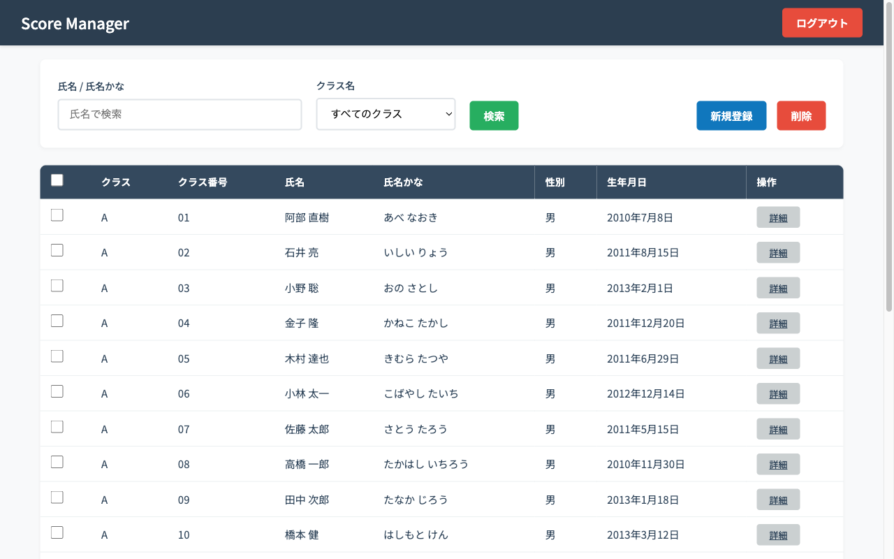
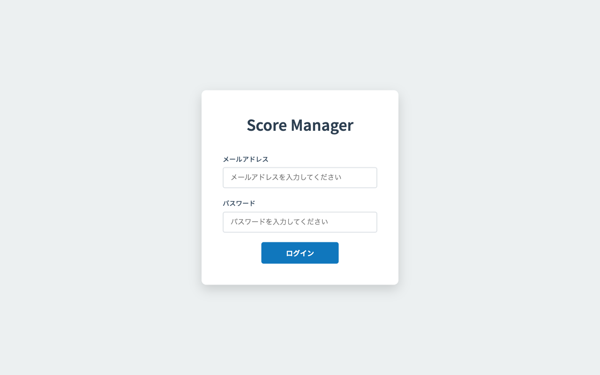
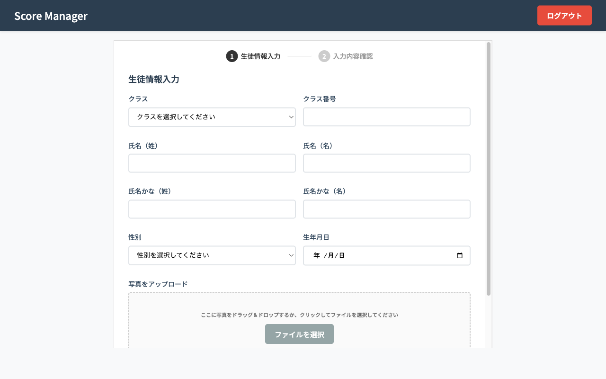
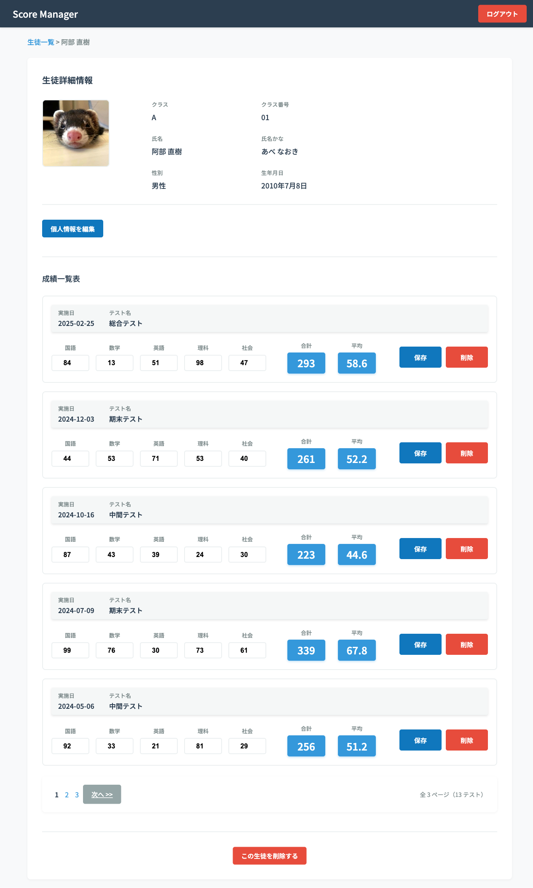

# Score Manager（生徒管理システム）

学校の先生が、生徒の情報とテストの成績をまとめて管理するための Web アプリです。
学習の課題として、PHP と MySQL で作りました。



## できること

- **ログイン／ログアウト**（ログインしていないと各画面に入れない）
- **生徒一覧**：氏名・ふりがな・クラスで検索、20人ずつページ送り、まとめて削除
- **生徒の新規登録**：入力 → 確認の2段階。顔写真のアップロード（ドラッグ＆ドロップ対応）
- **生徒の詳細**：個人情報の編集・削除、テストごとの成績（5教科）の入力・保存・削除、合計点と平均点の自動計算

| ログイン | 生徒の新規登録 |
|---|---|
|  |  |



## 使った技術

| 分類 | 技術 |
|---|---|
| 言語 | PHP 7.3、JavaScript、HTML／CSS |
| データベース | MySQL 8.0 |
| 環境 | Docker（docker compose）、phpMyAdmin |
| その他 | Git／GitHub |

フレームワークは使わず、データベースへの接続（PDO）、ログイン、入力チェック、CSRF 対策のトークン、画像アップロードを実装しています。

## 工夫したところ

フレームワークを使わずに作ったため、安全対策を自分で書き足しました。

- **エスケープ**：画面に出す値の記号を無害な文字に置き換え、悪意のあるスクリプトが動かないようにした（XSS 対策）
- **トークン**：フォームに合言葉を埋め込み、自分のサイトから送られたものかを確かめるようにした（CSRF 対策）
- **プレースホルダー**：SQL に値を直接つなげず後から当てはめ、SQL インジェクションを防いだ

## 動かし方

1. `docker compose up -d` でコンテナを起動する
2. phpMyAdmin（http://localhost:8080）を開き、`scoremanager` データベースに `scoremanager.sql` をインポートする
3. http://localhost を開いてログインする
   - メールアドレス：teacher@example.com
   - パスワード：teacher1234（お試し用）

## フォルダ構成

```
.
├── docker-compose.yml
├── mysql/             MySQL の設定
├── php/               PHP の設定
├── scoremanager.sql   テーブルとサンプルデータ（生徒150人分・架空の名前）
└── work/
    ├── app/           クラス（生徒・成績・ユーザー・画像アップロードなど）
    └── public/        画面（PHP）と CSS／JavaScript
```
